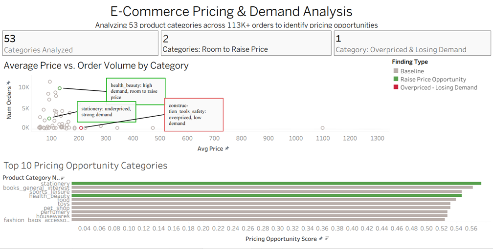

# E-Commerce Product Pricing & Demand Analysis

Analyzed pricing, ratings, and order-volume data across 53 product categories using SQL and Python to identify potential pricing opportunities and recommend categories for further testing.

## 📊 Dashboard

[View Live Interactive Dashboard on Tableau Public](https://public.tableau.com/app/profile/manashri.s/viz/ecommerce-pricing-dashboard2/Dashboard1?publish=yes)

## 🔍 Key Findings
- **`stationery` and `health_beauty`** showed relatively high order volume, favorable review scores, and comparatively low average prices, making them potential candidates for controlled price-increase experiments.
- **`construction_tools_safety`** showed relatively high average prices and low order volume compared with higher-volume categories. This warrants further investigation into product pricing, assortment, and potential targeted promotions or bundles.
- Review scores varied relatively little across the analyzed categories. Since ratings showed limited variation, the analysis focused primarily on price and order-volume patterns to identify potential pricing opportunities.

## 📈 Recommendation
Run a controlled price-increase test on `stationery` and `health_beauty`, and test a promotional discount or bundling strategy on `construction_tools_safety` to lift order volume. Full reasoning in [`recommendation_memo.md`](recommendation_memo.md.txt).

## 🛠️ Tech Stack
- **SQL** — category-level aggregation, pricing opportunity scoring
- **Python (pandas)** — data cleaning and transformation
- **Tableau** — interactive dashboard and visualization

## 📁 Project Structure
ecommerce-pricing-analysis/
├── data/ # Raw and cleaned datasets
├── python/ # Data cleaning & analysis scripts
├── sql/ # SQL queries
├── dashboard/ # Tableau workbook
├── screenshots/ # Dashboard preview image
├── recommendation_memo.md.txt # Written findings & recommendation
└── README.md

## 📌 Data Source
[Olist Brazilian E-Commerce Public Dataset](https://www.kaggle.com/datasets/olistbr/brazilian-ecommerce) (Kaggle, public domain) — 113,314 order-item records across 53 product categories.
